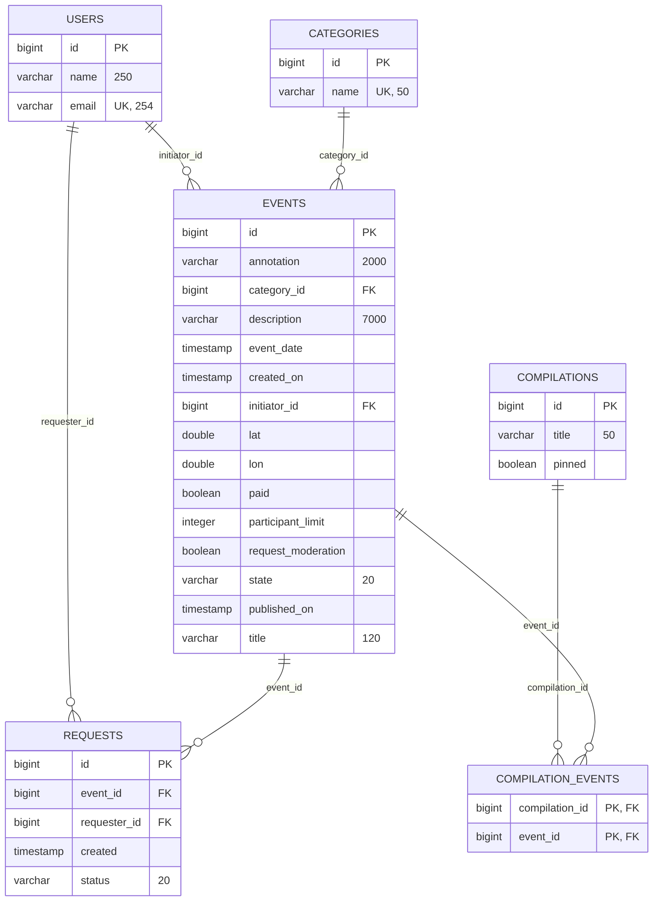
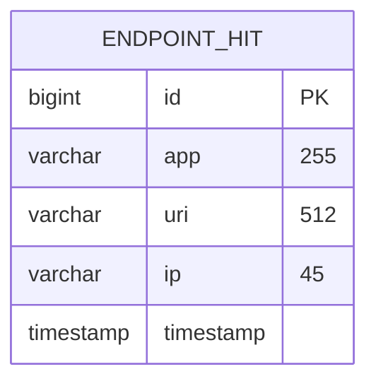

# Explore With Me Plus

Афиша событий: пользователи создают события (выставки, походы в кино, поездки),
находят компанию и подают заявки на участие. Администраторы модерируют события,
ведут категории, подборки и пользователей.

## Сервисы

| Сервис | БД                                         | Назначение                          |
|---|--------------------------------------------|-------------------------------------|
| `stats-server`| `ewm-stats`                                | Сбор и выдача статистики просмотров |
| `main-service` | `ewm-main`|  Основная бизнес-логика продукта    |

## Схема БД

### `ewm-main` — основная БД

### `ewm-stats` — БД статистики

